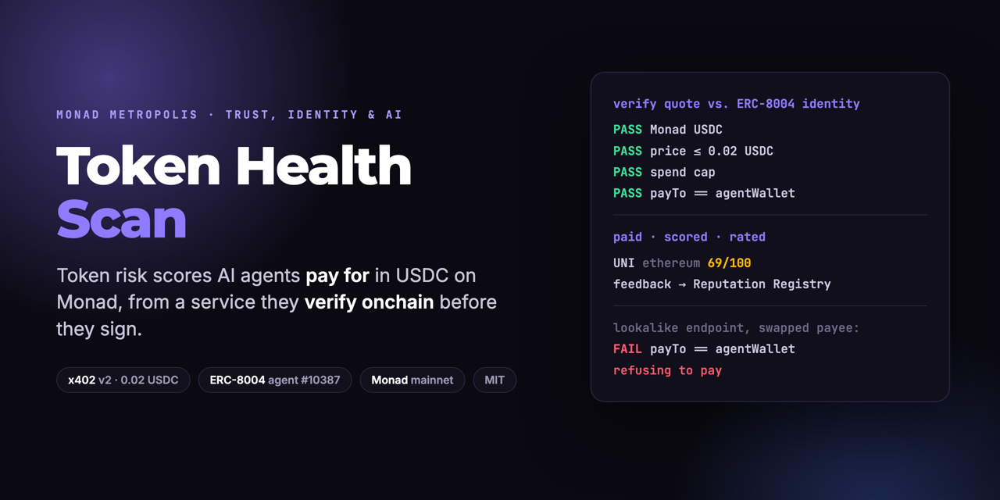
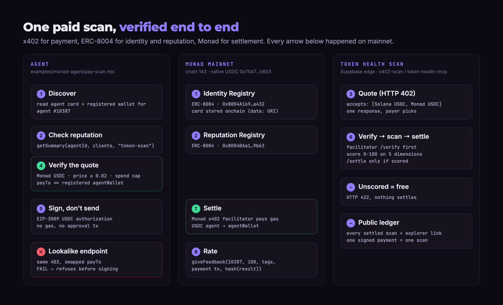

# Token Health Scan

    

**Token risk scores that AI agents pay for per call, in USDC on Monad, from a service they can verify onchain before they sign.**

**Try it live: [ths-monad.pages.dev](https://ths-monad.pages.dev)**. Reads the ERC-8004 identity and reputation straight from Monad, gets a quote, runs the payee check, and lets you buy a scan with your own wallet.

An agent about to buy a token needs to know if it's a trap. It can't sign up for a dashboard, can't hold an API key, and
can't tell a real service from a fake one. Token Health Scan sells a 0-100 health score for **0.02 USDC per scan over
x402**, settled on Monad, and is registered as **ERC-8004 agent #10387** so an agent can check who it's paying first.
Built for the Monad Metropolis hackathon, Trust, Identity & AI Infrastructure track.

## What it does

| Feature | What it does | Status |
|---|---|---|
| **Token scan** | 0-100 score across security, liquidity, tokenomics, community and development, for tokens on Ethereum, Base, BNB Chain, Polygon, Arbitrum and Solana | Shipped |
| **x402 on Monad** | Pay per scan in native USDC on Monad. EIP-3009 authorization, the Monad facilitator pays gas | Shipped |
| **Multi-network 402** | One 402 response quotes Monad, Solana and Base. The payer picks the rail | Shipped |
| **Pay only for a result** | Verify, then scan, then settle. Unscored tokens return 422 and nothing settles | Shipped |
| **ERC-8004 identity** | Agent #10387 on Monad. The x402 payee is the wallet the Identity Registry records | Shipped |
| **Trust-checking agent** | Reads identity and reputation, refuses a quote that pays anyone else, rates the service after | Shipped |
| **ERC-8004 feedback** | Each rating links the payment tx and a hash of the result | Shipped |
| **Paid MCP tool** | The same paid scan over MCP (`_meta["x402/payment"]`) | Shipped |
| **Public ledger** | Every settled scan with its explorer link | Shipped |
| **Onchain reconciliation (Envio HyperSync)** | Full ERC-8004 feedback history + every USDC payment to the agent, read via HyperSync; ratings count only if a real payment backs them; ledger checked against the chain | Shipped |
| **Evidence in every report** | Each input behind each score: value, points earned, inputs excluded and why | Shipped |
| **Apify Store** | The same scan for buyers without a wallet: [apify.com/gmangabeira2/token-health-scan](https://apify.com/gmangabeira2/token-health-scan), $0.02 per scored token. Source in [`apify-actor/`](apify-actor/) | Shipped |

## Live on Monad mainnet (verifiable now)

Every row is a real transaction. Click to verify.

| What | Transaction |
|---|---|
| ERC-8004 registration, agent #10387 | [`0x0a049fbc…9941ff37`](https://monadvision.com/tx/0x0a049fbcd3260435f9940435b82264d5d5e63bc34ddfb1b3a96232fa9941ff37) |
| Agent card written onchain (`setAgentURI`) | [`0x3f9c5812…09381f7a`](https://monadvision.com/tx/0x3f9c58120c7f1454e4aa349f512ead84db176104db96e0d4c8a37b5009381f7a) |
| Paid scan: UNI (Ethereum), score 69 | [`0x3a8ef5d0…9d11d214`](https://monadvision.com/tx/0x3a8ef5d0d355787c7e875854fc18b1d8799f6af320a769a983504fef9d11d214) |
| Feedback for that scan | [`0x725691a9…7e1c7398`](https://monadvision.com/tx/0x725691a9df896d7dc69b0e9b4c7d27d15fd27df5a45fc722a2ff4a5b7e1c7398) |
| Paid scan: AERO (Base), score 64 | [`0x32327b35…a68409c8`](https://monadvision.com/tx/0x32327b352ae094647abc0ec0a437f72422b271b897af5792994a116fa68409c8) |
| Paid scan: ARB (Arbitrum), score 63 | [`0x3bd2ad87…156faa3e`](https://monadvision.com/tx/0x3bd2ad87f709aaa2cbf274894c3a203e19f069339c467d47c4d2136c156faa3e) |
| Paid scan: JUP (Solana), score 68 | [`0x7e816f67…f6aa73d4`](https://monadvision.com/tx/0x7e816f672e9d399cde5ec0ec2381c2dbd0d8cae40c0b9a1fcc80a5eef6aa73d4) |

All four feedback transactions are listed in [`examples/monad-agent/README.md`](examples/monad-agent/README.md#onchain-record-monad-mainnet-2026-10-13).
Agent page: [8004scan.io/agents/monad/10387](https://8004scan.io/agents/monad/10387). Ledger:
[`/functions/v1/x402-ledger`](https://qaqebpcqespvzbfwawlp.supabase.co/functions/v1/x402-ledger).

| Contract / address | Value |
|---|---|
| ERC-8004 Identity Registry | [`0x8004A169FB4a3325136EB29fA0ceB6D2e539a432`](https://monadvision.com/address/0x8004A169FB4a3325136EB29fA0ceB6D2e539a432) |
| ERC-8004 Reputation Registry | [`0x8004BAa17C55a88189AE136b182e5fdA19dE9b63`](https://monadvision.com/address/0x8004BAa17C55a88189AE136b182e5fdA19dE9b63) |
| Agent wallet = x402 payee | [`0x12C479936bE431fBea60c376112561252b1E68Bb`](https://monadvision.com/address/0x12C479936bE431fBea60c376112561252b1E68Bb) |
| USDC (Circle, native on Monad) | `0x754704Bc059F8C67012fEd69BC8A327a5aafb603` |
| x402 facilitator | `https://x402-facilitator.molandak.org` |

## Why this is different

**Agent payments have a trust gap, and this closes it at the payee.** x402 makes any endpoint payable, but it doesn't
tell the payer whether the endpoint is the real service. Here the x402 `payTo` is the exact wallet ERC-8004 records for
agent #10387. A lookalike endpoint can copy the 402 byte for byte, but it can't change the registry. The demo agent
checks this before it signs, and the impersonation test in [`spoof-server.mjs`](examples/monad-agent/spoof-server.mjs)
shows it refusing.

**Reputation that can't be padded with free reviews, and we check.** Every ERC-8004 feedback entry the agent posts carries the
payment transaction as its `feedbackURI` and a hash of the scan result as its `feedbackHash`. A rating points to a
real, paid call anyone can open. The [`x402-onchain`](https://qaqebpcqespvzbfwawlp.supabase.co/functions/v1/x402-onchain) endpoint reads the full feedback history through Envio HyperSync and counts a rating only if a matching USDC payment exists. It already caught one: an unpaid 5/100 rating from an unknown address, shown on the page but not counted.

**The payer only pays for an answer.** The server verifies the signed authorization, runs the scan, and settles only if
the scanner produced a score. A token the scanner can't verify returns 422 with the partial data, free.

**Built on a scanner that's already in production.** The same engine serves [tokenhealthscan.com](https://tokenhealthscan.com):
null-gated v2 scoring (a missing data point is "not scored", never a fake zero) and a daily golden-set check against
hand-verified values.

## Architecture



```
supabase/functions/
  _shared/
    x402.ts              # x402 v2 exact scheme: Solana + Monad rails, quotes, verify/settle with timeouts
    x402.test.ts         # rail config, Monad EIP-3009 domain, payee/amount tamper checks
    paidScan.ts          # verify -> scan -> settle, one payment = one scan, ledger writes
    scanner/             # scoring engine (security, liquidity, tokenomics, community, development)
  x402-scan/             # paid HTTP endpoint (402 / PAYMENT-SIGNATURE / PAYMENT-RESPONSE)
  x402-ledger/           # public read-only ledger (with per-scan evidence)
  x402-onchain/          # Envio HyperSync: ERC-8004 feedback + USDC payments on Monad, ledger reconciliation
  token-health-mcp/      # MCP server, paid scan via _meta["x402/payment"]
  run-token-scan/        # the scan itself
examples/monad-web/
  index.html             # ths-monad.pages.dev: live identity, reputation, quote check, pay from your wallet
examples/monad-agent/
  register-ths.mjs       # mints the ERC-8004 identity, writes the agent card onchain
  pay-scan.mjs           # the trust-checking agent: discover, check, verify quote, pay, rate
  spoof-server.mjs       # impersonation test: real 402, swapped payee
  ths-agent.json         # agentId 10387 + registration tx
  spend-log.json         # every paid scan this agent made
src/                     # tokenhealthscan.com web app (React, Vite)
```

## Quick start

Requires Node 18+. The agent needs a Monad wallet with a little USDC (0.02 per scan) and MON for the feedback gas.

```bash
git clone https://github.com/gogrowth-co/token-health-radar
cd token-health-radar/examples/monad-agent
npm install

# key file: ~/.config/ths-x402/monad-payer.json  {"address": "0x...", "privateKey": "0x..."}
node pay-scan.mjs ethereum 0x1f9840a85d5af5bf1d1762f925bdaddc4201f984

# impersonation test (no money moves)
node spoof-server.mjs &
node pay-scan.mjs ethereum 0x1f9840a85d5af5bf1d1762f925bdaddc4201f984 --endpoint http://localhost:4020
```

Just want to see the quote? No wallet needed:

```bash
curl -i "https://qaqebpcqespvzbfwawlp.supabase.co/functions/v1/x402-scan?chain=base&address=0x940181a94a35a4569e4529a3cdfb74e38fd98631"
# HTTP 402, PAYMENT-REQUIRED header, accepts: [Solana USDC, Monad USDC]
```

Guards in the agent: Monad USDC only, price cap `MAX_PRICE_ATOMIC` (default 0.02 USDC), payee must equal the
registered agent wallet, lifetime spend cap `SPEND_CAP_ATOMIC` (default 1 USDC).

## Security

- No private keys in the repo. Agent keys load from `~/.config/ths-x402/*.json` (mode 600) or a `*_KEY_FILE` env var.
- The server never holds keys and never signs. Payers sign; the facilitator broadcasts; USDC goes straight to the payee.
- A signed payment is bound to the token it was quoted for, and its payload hash is unique in the ledger, so it buys
  exactly one scan. A cheaper amount, another asset or a redirected payee fails the match.
- Facilitator calls time out, so a hung facilitator leaves a retryable ledger row, never a stuck one.

## Built during Metropolis (1 Sep to 13 Oct 2026)

| Date | Work |
|---|---|
| 14 Sep | Nansen and Chainbase holder concentration, price volatility, provider fallbacks (#26-#31) |
| 25 Sep | Scanner reliability layer: v2 null-gated scoring, "Not scored" state (#33-#38) |
| 8 Oct | x402 pay-per-scan in USDC on Solana, HTTP + MCP, public ledger, MIT license (#39) |
| 13 Oct | Monad rail, multi-network 402, ERC-8004 identity, trust-checking agent, impersonation test |

Existed before 1 Sep: the scanner and its five dimensions, the web app and the MCP server. The Solana x402 rail was also
entered in Colosseum's Crypto World's Fair. Everything on Monad is new for Metropolis.

## Develop

The web app is a Vite + React + TypeScript + Tailwind + shadcn-ui project, edited through
[Lovable](https://lovable.dev/projects/77bad5d3-4413-4c36-8c05-5c134751e1f5) and this repo (both stay in sync).
Edge functions live in `supabase/functions/` and deploy with the Supabase CLI.

```bash
npm i
npm run dev
deno test --allow-env supabase/functions/_shared/x402.test.ts
```

## License

MIT (see [`LICENSE`](LICENSE)). x402 is an open protocol ([x402.org](https://www.x402.org)); ERC-8004 registries are
the canonical deployments on Monad ([docs](https://docs.monad.xyz/guides/erc-8004)).
